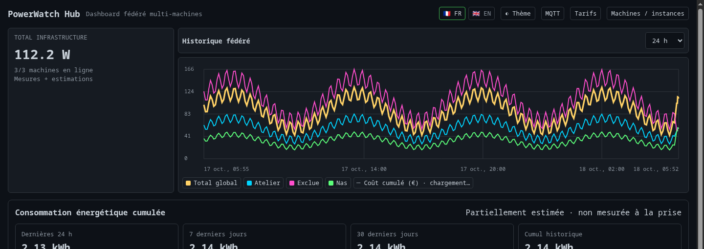

# PowerWatch
<p align="center">
  
</p>

<p align="center">
  <a href="README.md">Français</a> · <strong>English</strong>
</p>

<p align="center">
  
</p>

<p align="center">
  <em>PowerWatch Hub centralizes the power usage of multiple machines in one dashboard.</em>
</p>

## Contents

- [Features](#features)
- [Measurements](#measurements)
  - [ARM boards and measurement coverage](#arm-boards-and-measurement-coverage)
  - [RAM and power supply](#ram-and-power-supply)
- [Docker installation](#docker-installation)
  - [Requirements](#requirements)
  - [Quick start](#quick-start)
  - [CPU RAPL via MSR](#cpu-rapl-via-msr--synology-dsm-and-kernels-without-powercap)
- [Native compilation](#native-compilation)
- [GPU](#gpu)
  - [AMD](#amd)
  - [Intel](#intel)
  - [NVIDIA](#nvidia)
- [Disks, partitions, and storage](#disks-partitions-and-storage)
- [Web UI](#web-ui)
  - [French electricity tariffs — beta (optional)](#french-electricity-tariffs--beta-optional)
- [Persistent energy consumption (kWh)](#persistent-energy-consumption-kwh)
- [History](#history)
- [Alerts and notifications](#alerts-and-notifications)
- [Integrated authentication](#integrated-authentication)
- [CLI and TUI in Docker](#cli-and-tui-in-docker)
- [Check detected sensors](#check-detected-sensors)
- [PowerWatch Hub](#powerwatch-hub--multiple-machines-one-dashboard)
  - [Selecting instances for energy totals](#selecting-instances-for-energy-totals)
  - [Start the Hub](#start-the-hub)
- [Home Assistant — MQTT Discovery](#home-assistant--optional-mqtt-discovery)
- [Security](#security)
- [Attribution](#attribution)
- [License](#license)

**PowerWatch** monitors the power consumption of a Linux machine from Docker and displays it in a Web UI, with history, alerts, and several measured or estimated hardware sources.

This fork is primarily designed for **servers, mini PCs, Linux desktop machines, and Docker hosts**. **Docker remains the recommended and best-controlled deployment method**; native compilation from source is also documented for advanced users.

> **Security:** integrated authentication is optional and disabled by default. Without it, use the Web UI only on a **trusted private LAN**.

## Features

- Real-time Web UI with historical views and a **cumulative energy cost** curve in euros in PowerWatch and the Hub.
- Dedicated **Tariffs** page with a single form and navigation without nested accordions.
- Persistent SQLite history with long-term aggregation.
- Alerts configurable from the Web UI.
- **Discord** and **Apprise API** notifications.
- Multi-GPU **NVIDIA / AMD / Intel** detection.
- **Intel RAPL `uncore` fallback** for some iGPUs without i915/xe hwmon counters.
- CPU **RAPL fallback through `/dev/cpu/0/msr`** when the kernel does not expose `powercap` (including some Synology DSM systems).
- Monitoring of all **physical disks** without double-counting RAID/LVM layers, including their capacity.
- Best-effort display of associated **mounted partitions, filesystems, mdraid, LVM, and dm-crypt**, without noise from unmounted partitions.
- CLI and TUI available in the Docker image.
- Multi-architecture **amd64 / arm64** GHCR images.
- ARM boards: a wall-calibrated whole-board power model; Raspberry Pi 5 PMIC rail measurements when `/dev/vcio_gencmd` is available.
- **French / English** Web UI.
- Optional Web UI authentication with one administrator account, persistent sessions, and read-only API tokens.
- Configurable PowerWatch instance name, automatically suggested when adding the instance to the Hub while keeping the Hub alias independent.
- CPU model with a direct **CPU Benchmark / PassMark** search link and monochrome CPU/RAM/disk icons.
- Best-effort RAM inventory: **installed capacity, populated memory-device count, and per-module details** through SMBIOS when available.
- Best-effort power-supply information through **SMBIOS Type 39**: nominal maximum capacity, manufacturer/model, location, type, and status when firmware reports them.
- **PowerWatch Hub**: aggregate multiple machines into one federated dashboard.
- **Home Assistant (MQTT Discovery)**: optional automatic W/kWh and estimated EUR-cost sensors from standalone nodes or Hub.

## Measurements

### ARM boards and measurement coverage

On Linux ARM64 or ARMv7, `POWERWATCH_BOARD_IDLE_W` and `POWERWATCH_BOARD_MAX_W` enable a **Board** model calibrated at the wall socket. Measure the board **and peripherals powered by the same plug** at a stable idle, then with all CPU cores under sustained load. Use those two watt readings as the variables: `Board = idle + (maximum − idle) × CPU utilization`. No coefficient is guessed. The reading remains **estimated** and never replaces available RAPL/MSR telemetry. RAM, storage and supply losses present during calibration are already included and are not added again. Peripheral load that changes independently of the CPU may not be captured by this model.

In `compose.yaml`, add both measured values under `services.powerwatch.environment`, for example `POWERWATCH_BOARD_IDLE_W: ${POWERWATCH_BOARD_IDLE_W:-}` and `POWERWATCH_BOARD_MAX_W: ${POWERWATCH_BOARD_MAX_W:-}`, then set them in `.env`. These numbers belong to **your** installation; readings from another board are not suitable. With both values absent, the model stays off; one missing or invalid value appears as a sensor error.

On Raspberry Pi 5, the PMIC reads rails through `/dev/vcio_gencmd` (the `video` group). For Docker, add this under `services.powerwatch`:

```yaml
devices:
  - /dev/vcio_gencmd:/dev/vcio_gencmd
```

Check that the device exists on the host and the process can open it; native users generally need membership in `video`. The official container runs as root and does not require `privileged: true`. If container isolation hides board identity, also expose `/proc/device-tree` read-only so retry attempts after an initial failure can recognize Pi 5. The PMIC measures rails but excludes devices powered directly from 5 V (USB, PCIe/NVMe, fan) and supply losses. Totals, kWh and euros based only on this source are therefore **partial lower bounds**, with no invented power for uncovered loads. USB/NVMe estimates can be added; RAM and SD card are not counted twice. An explicitly configured wall-calibrated model takes priority over PMIC.

Published images support amd64 and arm64. The ARMv7 binary was built and tried natively on Raspberry Pi 2 B; the model was also tried on Pi 3 A+, Pi 4 B and Pi 5. No ARMv7 Docker image is published.


| Component | Source | Type |
|---|---|---|
| CPU | Linux RAPL (`powercap` or MSR `/dev/cpu/0/msr`) | Measured |
| ARM board (model) | CPU load and wall-socket calibration | Estimated |
| Raspberry Pi 5 (PMIC) | PMIC rails through `/dev/vcio_gencmd` | Measured, partial |
| NVIDIA GPU | NVML | Measured |
| AMD GPU | `amdgpu` hwmon | Measured |
| Intel GPU | `i915` / `xe` hwmon or RAPL `uncore` | Measured |
| RAM | Heuristic | Estimated |
| Disks | Busy time (`/proc/diskstats`) + media profile; NVMe power states when available | Estimated |
| Total | Sum of available sensors | Mixed |

Unavailable sensors are simply ignored.

On some Intel systems, PowerWatch can use the RAPL `uncore` subdomain as the iGPU power reading. In that case, CPU power is calculated from the package value minus `uncore` so the iGPU is not counted twice.

When the Linux `powercap` interface is absent but `/dev/cpu/0/msr` exists, PowerWatch can directly read the RAPL `MSR_RAPL_POWER_UNIT` (`0x606`) and `MSR_PKG_ENERGY_STATUS` (`0x611`) registers. This remains a **hardware-measured** CPU-package value, not an estimate based on CPU utilization.

### RAM and power supply

PowerWatch complements electrical readings with a small best-effort hardware inventory shown in the local Web UI and forwarded to the Hub.

For **RAM**:

- usable total memory is read from `/proc/meminfo`;
- PowerWatch first reads the kernel's raw SMBIOS/DMI table to recover physically installed capacity and populated memory devices;
- the interface **groups identical populated devices** into a compact summary (e.g. `2 × 16 GiB · DDR4 · 3200 MT/s`), without displaying long vendor part numbers or slot locations; full metadata remains accessible in the API;
- the displayed count is the number of populated **SMBIOS Memory Devices**. On some systems, soldered memory can therefore appear as a module even though it is not a removable DIMM;
- if SMBIOS is unavailable, PowerWatch displays **usable** Linux memory and no longer labels that fallback value as “Installed RAM”.

For the **power supply**:

- PowerWatch reads SMBIOS **Type 39 / System Power Supply**;
- generic firmware entries (`Default string`, `OEM Define`, status/type alone without credible identity or capacity) and explicitly absent PSU bays are hidden;
- the Web UI and Hub display **one compact PSU summary**, without repeating the wattage on the same line; optional details remain available in a tooltip;
- reported capacities are explicitly labeled **“SMBIOS unverified”**: even a plausible value may not match the real PSU rating;
- the watt value is an **SMBIOS-reported nominal maximum capacity, not physically verified**, not live electrical consumption;
- nominal PSU capacity is **never added** to the PowerWatch consumption total.

Docker masks `/sys/firmware` inside containers by default. The PowerWatch Compose therefore mounts the host firmware read-only at `/host-sys-firmware` and sets `POWERWATCH_DMI_TABLE_PATH=/host-sys-firmware/dmi/tables/DMI`. PowerWatch parses that raw table directly, so neither `privileged` mode nor `/dev/mem` access is required.

Many consumer motherboards and standard ATX PSUs do not expose SMBIOS Type 39 at all. PowerWatch now distinguishes **SMBIOS unavailable** from **PSU not exposed by SMBIOS firmware** instead of treating both cases as the same condition. `dmidecode` remains available as a fallback when the raw table cannot be read.

## Docker installation

### Requirements

- Linux;
- Docker Engine;
- Docker Compose;
- read access to `/sys` from the container;
- for NVIDIA: NVIDIA driver + NVIDIA Container Toolkit on the host.

### Quick start

```bash
git clone https://github.com/Aerya/PowerWatch.git
cd PowerWatch

cp .env.example .env
docker compose pull
docker compose up -d
```

By default, the Compose file exposes the Web UI only on:

```text
127.0.0.1:3000
```

To make it available on your local network, edit `.env` and set the **private IPv4 address of the server**:

```env
POWERWATCH_BIND_IP=192.168.0.50
```

Then restart:

```bash
docker compose up -d
```

The Web UI will then be available at:

```text
http://192.168.0.50:3000
```

The supplied [`compose.yaml`](compose.yaml) is the reference deployment file.

### CPU RAPL via MSR — Synology DSM and kernels without `powercap`

On some Intel systems, including some **Synology DSM** hosts, the kernel does not expose `/sys/.../powercap` even though `/dev/cpu/0/msr` is available.

In that case, uncomment both blocks in `compose.yaml`:

```yaml
cap_add:
  - SYS_RAWIO

devices:
  - /dev/cpu/0/msr:/dev/cpu/0/msr:r
```

The Linux `msr` driver requires **`CAP_SYS_RAWIO`** to open `/dev/cpu/*/msr`, even when the container process runs as root. `privileged: true` is not required: enable only `SYS_RAWIO` together with the MSR device when this fallback is actually needed.

PowerWatch always prefers `powercap`. MSR is used only as a fallback when no RAPL `powercap` domain is discovered. Only one CPU device is required: `MSR_PKG_ENERGY_STATUS` is **package-wide**, so `/dev/cpu/0/msr` and `/dev/cpu/1/msr` must not be summed.

For hardware and Docker details, see [`DOCKER.md`](DOCKER.md).

## Native compilation

Docker remains the recommended deployment method for PowerWatch. Native compilation is intended for advanced users who want to run the binaries directly on their Linux distribution.

### Requirements

You need:

- **Git**;
- a recent stable **Rust** and **Cargo** toolchain;
- a working C build toolchain (`gcc` or `clang`, linker, `make`, etc.).

Rust can be installed using the official [`rustup`](https://rustup.rs/) method.

Common system prerequisite examples:

```bash
# Debian / Ubuntu
sudo apt install build-essential pkg-config git curl dmidecode

# Fedora
sudo dnf group install "Development Tools"
sudo dnf install git pkgconf-pkg-config curl dmidecode

# Arch Linux / Garuda
sudo pacman -S --needed base-devel git curl dmidecode
```

### Build PowerWatch

Clone the repository and build the complete workspace in release mode:

```bash
git clone https://github.com/Aerya/PowerWatch.git
cd PowerWatch
cargo build --release --workspace
```

The four executables are generated under `target/release/`:

```text
powerwatch
powerwatch-tui
powerwatch-web
powerwatch-hub
```

### Run the binaries

CLI:

```bash
./target/release/powerwatch
./target/release/powerwatch --json
```

TUI:

```bash
./target/release/powerwatch-tui
```

Local Web UI with history:

```bash
./target/release/powerwatch-web   --host 127.0.0.1   --port 3000   --log   --history-interval 60
```

For a server/headless system, add `--nas-mode`. Optional authentication is enabled with `--auth` or `POWERWATCH_AUTH_ENABLED=true`; without it, restrict a LAN listener to a trusted private network.

Hub with its configuration and history files stored in the current directory:

```bash
./target/release/powerwatch-hub   --host 127.0.0.1   --port 3065   --config ./powerwatch-hub.json   --database ./powerwatch-hub.db
```

### Hardware access

When running natively, PowerWatch reads the hardware interfaces exposed by Linux directly, so there are no Docker bind mounts to configure.

- **NVIDIA**: NVIDIA Container Toolkit is not required for native execution. The NVIDIA driver/NVML only needs to work on the host; `nvidia-smi` can be used to verify it.
- **AMD / Intel**: available counters under `/sys` are read directly.
- **RAPL MSR**: if the `/dev/cpu/0/msr` fallback is required, the process must have the permissions/capabilities required by the kernel to open the device, including `CAP_SYS_RAWIO` depending on the host configuration.

> **Support:** native compilation is provided as an advanced option. Dependencies, permissions, hardware paths, and behavior can vary across distributions and kernels. Docker remains the reference deployment documented and tested by PowerWatch CI.

## GPU

### AMD

No additional Docker configuration is required. PowerWatch reads the Linux `amdgpu` counters exposed in `/sys`.

### Intel

PowerWatch first uses the `i915` / `xe` counters available through `hwmon`.

When they do not provide power telemetry but RAPL exposes an `uncore` subdomain, it can be used as the `gpu:intel:0` fallback.

### NVIDIA

NVIDIA support relies on **NVML**. The NVIDIA driver must work on the host and **NVIDIA Container Toolkit must be installed and configured for Docker**.

First verify the host driver:

```bash
nvidia-smi
```

Then verify/install NVIDIA Container Toolkit and configure the Docker runtime:

```bash
sudo nvidia-ctk runtime configure --runtime=docker
sudo systemctl restart docker
```

Before starting PowerWatch, validate GPU access from Docker:

```bash
docker run --rm --runtime=nvidia --gpus all ubuntu nvidia-smi
```

If this command shows the GPU, Docker/NVIDIA is correctly configured. You can then uncomment `NVIDIA_VISIBLE_DEVICES` / `NVIDIA_DRIVER_CAPABILITIES` and the `deploy.resources.reservations.devices` block in `compose.yaml`, then recreate PowerWatch:

```bash
docker compose up -d --force-recreate
```

If Docker reports:

```text
could not select device driver "nvidia" with capabilities: [[gpu]]
```

the failure happens **before PowerWatch starts**: Docker does not yet have a usable NVIDIA runtime. Bind-mounting `nvidia-smi` into the container does not fix this.

On Ubuntu/Debian, if `nvidia-container-toolkit` is not available from your currently configured repositories, follow NVIDIA's official installation instructions before running `nvidia-ctk`: [NVIDIA Container Toolkit — Install Guide](https://docs.nvidia.com/datacenter/cloud-native/container-toolkit/latest/install-guide.html).

`NVIDIA_DRIVER_CAPABILITIES: utility` is sufficient for PowerWatch to access NVML; no graphics stack is required. Multiple GPUs and mixed AMD/Intel/NVIDIA systems are supported whenever the corresponding counters are readable.

PowerWatch first reads direct power through NVML. If that read fails but the driver provides power samples, it uses the newest sample to measure the GPU and include it in the total. To check this case, compare `nvidia-smi --query-gpu=power.draw --format=csv` with the “Power Samples” section of `nvidia-smi -q -d POWER`. If neither source is available, PowerWatch reports a read error.

## Disks, partitions, and storage

PowerWatch creates a power sensor only for each **physical disk**. Layers such as mdraid, LVM, and dm-crypt are not added as fake disks and therefore are not counted a second time.

When Linux can reconstruct the relationship, only chains that end in a **useful mounted filesystem** are displayed, for example:

```text
disk (sda) — sda1 → md0 [RAID1] → vg-data/lv-media [LVM] → /mnt/data [ext4]

disk (nvme0n1) — nvme0n1p2 → cryptroot [dm-crypt] → / [ext4]
```

Unmounted partitions are intentionally hidden. If a disk has no mounted partition, PowerWatch simply keeps the disk, its capacity, and its estimated power without adding an `[unmounted]` list. If some partitions are mounted and others are not, only the mounted ones are shown.

Each physical disk capacity is read from sysfs (`/sys/class/block/<device>/size`) and displayed in its enriched label. Internal identifiers remain stable (`disk:sda`, `disk:nvme0n1`, etc.) so mount changes do not break history or alerts.

### Disk power estimation

Disk values remain **estimates**, not direct electrical measurements. For generic profiles, PowerWatch uses the time the device was busy in `/proc/diskstats` between two samples and interpolates between an idle and an active value:

| Detected type | Idle | Active | Detection |
|---|---:|---:|---|
| Rotational HDD | 4 W | 8 W | `queue/rotational = 1` |
| Non-removable SSD | 0.5 W | 3 W | non-rotational and non-removable |
| Low-power flash (removable USB flash, eMMC/SD) | 0.2 W | 1.5 W | `removable = 1` or an `mmcblk*` device |
| NVMe generic fallback | 1 W | 6 W | `nvme*` device |

For example, an SSD busy for roughly 50% of the sampling interval is estimated halfway between 0.5 W and 3 W instead of immediately jumping to the full active value after any I/O. The ratio is clamped between 0 and 100%.

For NVMe drives, PowerWatch first tries to use `nvme-cli` together with the current power state exposed by sysfs. When available, it uses the maximum power advertised by the drive for the current power state. If that information is unavailable, PowerWatch falls back to the generic NVMe profile above.

Removable-media detection depends on what the kernel exposes, so a USB enclosure may be classified as HDD, SSD, or flash according to `rotational` and `removable`. Confidence remains **Estimated** in every case.

## Web UI

<p align="center">
  
</p>
<p align="center">
  
</p>


The main page displays:

- total power consumption;
- every detected sensor;
- the **measured / estimated** distinction;
- the history chart at the top, beside the total, with Live, 1 h, 6 h, 24 h, 7 d, 30 d, 180 d and 400 d presets plus a custom range;
- average, minimum, maximum, and energy;
- preset and custom time ranges;
- enriched disk labels including capacity;
- CPU model with a CPU Benchmark / PassMark link;
- an editable instance name reused as the suggested name when adding the instance to PowerWatch Hub;
- FR / EN language selection;
- top-right **Alerts**, **MQTT**, and **Tariffs** buttons: Home Assistant and pricing settings no longer occupy the dashboard;
- Light / Dark / Auto appearance control with separate day and night palettes inspired by Dockge-Enhanced. Browser preferences are stored separately for each WebUI or Hub origin.

Settings menus open one at a time and close with Escape or an outside click. Tariffs have a dedicated page; switching views preserves form drafts, and saves preserve calculation dates and scroll position. The Hub checks the administrator token before confirming it; settings that were initially unavailable load after entering the token without refreshing the page.

The Docker image automatically starts PowerWatch with history enabled and NAS/headless mode.

### French electricity tariffs — beta (optional)

<p align="center">
  
</p>

**Beta: prices may be incomplete, stale or inaccurate. Costs are estimates, not meter readings or invoices.** Disabled by default. Open the **Tariffs** page from a standalone instance or the Hub; “Enable costs” saves the choice immediately. Disabling it hides euro amounts from the dashboard while keeping saved contracts. SQLite keeps every contract and manual override on the server.

- Dated contracts, multiple suppliers across distinct time ranges, independent electric sites and Hub node assignments.
- Editable price revisions for Base, HP/HC (custom time windows), Tempo (six rates), and custom offers; edited values override external imports.
- Optional automatic/daily and on-demand sync of **EDF regulated Tarif Bleu** data from CRE CSV, selected by subscribed kVA; confirmed Tempo colors from independent calendrier-tempo.fr API (CC BY 4.0, not an EDF/RTE API).
- **Rate catalogue (France beta)**: in “My contract”, “Find rates in the catalogue” retrieves public VAT-inclusive grids from Kelwatt and fills the supplier → offer → Base / peak/off-peak → subscribed power form. Check the rates and meter hours, then press **Save**; searching alone never changes a contract. These prefilled rates then follow the manual entry workflow: search and save again to refresh them. A catalogue outage leaves saved tariffs untouched.
- **Dedicated `/tariffs` page**: the **Tariffs** button opens a full page with one navigation level: “My contract”, “Rate history”, “Sites and nodes” (Hub), and “Import / export”. Saved values prefill a single supplier → offer/plan/power → VAT-inclusive rates and hours → effective date → Save form. The catalogue fills this same form without saving implicitly. Base, peak/off-peak, Tempo, and custom peak/off-peak plans are supported. New rate dates preserve earlier revisions; “Change contract” preserves the previous contract with an end date. No nested accordions.
- **Historical prices**: if your supplier confirms that **the displayed prices** already applied on an earlier date, enter and confirm that date. Otherwise, saved rates start today. Earlier readings have no documented rate; the optional estimate below can show a separate rough amount. A current public grid alone does not establish a historical contract price.
- **Old offer or one missing from the catalogue (for example, “Online” since 2019)**: enter supplier, offer, plan, power, known VAT-inclusive rates from a bill or customer account, **monthly** standing charge and off-peak hours. If the rate start date is unknown, leave it blank: after confirmation, rates start today, not in 2019. “Save without changing rates” can also create a contract without prices. The active contract prefills the main form; **Edit** in “Rate history” reloads a selected period so it can be corrected without deleting other revisions. An old unpriced “Tarif Bleu” draft can be replaced after confirmation. No PDF, personal name, address or customer/meter identifier is imported into PowerWatch.
- **Optional historical estimate**: in “Import / export”, select “Estimate earlier readings using the first known rate” to show a separate approximate amount for readings before the first saved rate, provided a contract and the required meter hours exist. Saved historical rates are unchanged; periods without a contract or tariff category stay unavailable. The amount is labelled as a historical estimate using a later known rate, not an old bill.
- **Important limits**: offers with additional special bands (e.g. Heures Eco+ and Charge'Heures) are not mispriced as plain two-rate plans. Current public grids may differ from older fixed contracts or personal discounts, and do not recreate historical rates. **Meter-specific Linky off-peak slots** cannot be inferred from the supplier catalogue: check them with Enedis or the supplier. Without verified time slots, peak/off-peak electricity is left unpriced. Manual override remains available.
- Europe/Paris local time, DST, Tempo 06:00-to-06:00 day. 15-minute lifetime archives for newly compacted energy; legacy hourly energy is still supported and its price breakdown is flagged approximate.
- Optional prorated subscription counted **once per electric site**, not per node. The historical projection is opt-in and uses the first later documented rate; missing contracts, missing Tempo colors and unmonitored time are never assigned invented consumption or a tariff.
- Endpoints `/api/tariffs-fr` and `/api/hub/tariffs-fr` (plus `/sync`, `/cost`, `/overview` for counters, and `/series` for the curve; the Hub overview accepts an optional `nodes` filter); writes require the existing WebUI/Hub admin protection when enabled.
- **Opt-in copy between nodes**: from the Hub **Tariffs** page, open “Sites and nodes”, choose the source node, and select only nodes with the same electricity contract and off-peak hours. Select “Copy to Hub too” to price those nodes in the Hub. Copying replaces tariff settings on selected nodes only. If PowerWatch authentication is enabled, create a “Read and update electricity tariffs” token on each destination node's Security page and save it on that node's Hub card. The ordinary read-only token remains separate. Copying runs when you press the button and reports each node's result.

Sources: https://www.cre.fr/documents/open-data/historique-des-tarifs-reglementes-de-vente-delectricite-pour-les-consommateurs-residentiels.html and https://www.calendrier-tempo.fr/api-tempo.

## Persistent energy consumption (kWh)

> **Cost in the counters (instance and Hub)**: with French tariffs enabled, the 24-hour, 7-day, 30-day and lifetime counters show euro amounts below their kWh totals. Custom ranges use the same tariff engine. Hub costs follow the selected instance filter; optional standing charges are counted once per electricity site. A historical projection is explicitly labelled; any remaining unpriced share is marked partial or unavailable.


PowerWatch and PowerWatch Hub show **24 h, 7 d, 30 d, lifetime** and a custom start/end date-time. Hub also displays **per-node** kWh.

Energy is integrated between consecutive power readings only across sufficiently short sampling gaps. Downtime and missing telemetry **are not filled with invented electricity usage**; the observed coverage is displayed (in node-hours for Hub). As RAM/disk data may be estimated and PSU inefficiency is not monitored, **kWh are not a substitute for a plug-in power meter**.

The energy ledger is stored in SQLite independently of the Watts-history retention. Detailed intervals remain available for 45 days; new archives are consolidated into permanent 15-minute buckets; legacy hourly archives remain readable. First migration recovers only actual, sufficiently close raw historical observations; unrecorded periods cannot be reconstructed.

- Local API: `GET /api/energy?from=<ISO8601>&to=<ISO8601>` (optional parameters).
- Hub API: `GET /api/hub/energy?from=<ISO8601>&to=<ISO8601>` (global and per-node periods).
- The existing local History energy card remains separate from the new cumulative counters.

## History

PowerWatch and Hub charts include a dashed **cumulative cost of consumed energy** curve from the start of the displayed period, with a euro axis on the right and a legend toggle. Standing charges are excluded. The Hub sums enabled nodes included in its normal total, each using its assigned site contract; hiding a power series does not change this total. Missing rates or observations create gaps and mark the cumulative cost as partial. Optional historical projections remain labelled as estimates.


<p align="center">
  
</p>

Data is stored in SQLite in the persistent `./data` volume.

Current retention:

- raw measurements: **30 days**;
- 15-minute aggregates: **from 30 days to 1 year**;
- 1-hour aggregates: **beyond 1 year**.

Long time ranges are aggregated server-side to avoid unnecessarily sending thousands of points to the Web UI.

## Alerts and notifications

<p align="center">
  
</p>

The `/alerts` page lets you create persistent rules for:

- total power;
- CPU;
- all GPUs;
- a specific GPU (`gpu:nvidia:0`, `gpu:amd:0`, `gpu:intel:0`, etc.);
- RAM;
- a specific disk.

Each rule can define:

- a threshold in watts;
- a minimum over-threshold duration;
- enabled / disabled state;
- recovery notification.

Available notification methods:

- **Discord** via incoming webhook;
- **Apprise API**.

Alert settings are stored in the persistent Docker volume together with history data.

## Integrated authentication

PowerWatch can protect its Web UI and APIs with native authentication, without an HTTP browser popup or an external service. It is **disabled by default** to preserve existing installations.

For the first activation, add this to `.env`:

```dotenv
POWERWATCH_AUTH_ENABLED=true
POWERWATCH_AUTH_SETUP_TOKEN=a-long-unique-random-secret
```

The setup token must contain at least 16 characters. Restart PowerWatch, open the Web UI, then enter this token on the account-creation screen. This prevents a visitor who discovers the URL before the administrator from claiming the single account.

After creating the account, remove `POWERWATCH_AUTH_SETUP_TOKEN` from `.env` and recreate the container. The account, sessions, and integration tokens remain in `./data/auth.json` together with history and the other persistent data. Keep `POWERWATCH_AUTH_ENABLED=true` enabled.

The **Security** page lets you:

- change the password;
- revoke every session;
- create and revoke read-only Bearer API tokens;
- sign out.

Passwords are hashed with **Argon2id**. Sessions are stored server-side; the browser only receives an `HttpOnly`, `SameSite=Strict` cookie that is automatically marked `Secure` when the reverse proxy sends `X-Forwarded-Proto: https`. Session-authenticated actions also require a CSRF token.

### API for PowerWatch Hub and Dockge-Enhanced

Create a token from **Security**, copy it immediately — its full value will not be displayed again — then send it in the HTTP header:

```http
Authorization: Bearer pw_...
```

The token only grants read access to:

- `GET /api/snapshot`;
- `GET /api/history`;
- `GET /api/history/range`;
- `GET /api/instance`.

Authentication endpoints are:

- `GET /api/auth/status` — public status without secrets;
- `POST /api/auth/setup` — initial creation with `username`, `password`, and `setup_token`;
- `POST /api/auth/login` and `POST /api/auth/logout`;
- `GET /api/auth/settings`;
- `POST /api/auth/password`;
- `POST /api/auth/sessions/revoke`;
- `POST /api/auth/tokens` and `DELETE /api/auth/tokens/:id`.

`GET /api/health` stays public. Other data and action APIs reject unauthenticated calls when authentication is enabled. PowerWatch Hub accepts the optional token in each instance form and never exposes it in its API responses.

Hub administration operations can also be protected independently and optionally:

```dotenv
POWERWATCH_HUB_ADMIN_TOKEN=a-random-secret-with-at-least-24-characters
```

When this variable is set, adding, listing, changing, deleting, and testing instances requires `Authorization: Bearer <administrator token>`. The dashboard lets you enter this secret for the current tab; it is never returned by the API or added to URLs. `GET /api/hub/auth/status` only reports whether protection is enabled. Without the variable, the Hub keeps its historical behavior.

An already stored instance token remains bound to its current URL. If the URL changes without explicitly supplying a new token in the same request, the stored secret is removed instead of being sent to the new destination. Updates that keep the same URL preserve the existing token.

For an HTTPS reverse proxy, terminate TLS at the proxy, forward `X-Forwarded-Proto: https`, and replace any client-provided value instead of appending to it. PowerWatch does not terminate TLS itself.

## CLI and TUI in Docker

The Web UI is the main service, but the image also includes the CLI and TUI.

### Snapshot

```bash
docker exec powerwatch powerwatch
```

### JSON

```bash
docker exec powerwatch powerwatch --json
```

### CLI history

```bash
docker exec powerwatch powerwatch history --since 1h
```

### TUI

<p align="center">
  
</p>

```bash
docker exec -it powerwatch powerwatch-tui
```

Running the CLI or TUI with `docker exec` does not interrupt the Web UI.

## Check detected sensors

```bash
docker exec powerwatch powerwatch --json
```

Example GPU identifiers:

```text
gpu:nvidia:0
gpu:nvidia:1
gpu:amd:0
gpu:intel:0
```

To check RAPL directly inside the container:

```bash
docker exec powerwatch sh -c \
  'find /host-sys-virtual/powercap/intel-rapl -name energy_uj -o -name name 2>/dev/null'
```


## PowerWatch Hub — multiple machines, one dashboard

PowerWatch can also run in **Hub** mode. Each machine keeps its local PowerWatch instance and hardware collection; the Hub simply queries their HTTP APIs and groups them into a single Web UI.

<p align="center">
  
</p>

<p align="center">
  
</p>

The Hub provides:

- a **global infrastructure total** labeled **“Measured + estimated”**;
- one collapsible card per machine with CPU, GPU, RAM, and disks;
- **online / stale / offline / disabled** states;
- adding, testing, enabling, and removing instances from the top-right **Machines / instances** menu;
- the ability to exclude a machine from the global total;
- energy totals filtered by one, multiple, or all instances independently of the global total;
- federated SQLite history, stored every 60 seconds by default;
- automatic recovery of aggregated history already available on the nodes (up to 400 days);
- a federated graph with the **global total + one colored line per instance**;
- compact node cards with CPU / GPU / RAM / disk summaries and measured / estimated colors;
- an FR / EN interface visually aligned with the main PowerWatch Web UI.

The global total adds up the node values, **both measured and estimated**. It is not a wall-outlet power measurement, and nominal PSU capacity is never included.

The Hub requires **no `/sys` access, no `pid: host`, and no privileged host access**. It only needs network access to the private URLs of the PowerWatch instances.

### Selecting instances for energy totals

On the Hub **Cumulative energy consumption** panel, the **Energy instances** filter determines which machines contribute to the displayed totals:

- **Normal total** (default): sums only enabled instances marked **“include in total”**.
- **All**: includes all configured instances, even those disabled or excluded from the normal total, to the extent their recorded history is available.
- **Custom selection**: check individual instances to sum one machine or several. With none checked, the panel asks you to select at least one instance.

The selection affects the **last 24 hours, 7 days, 30 days, lifetime, custom date range**, and **coverage in machine-hours**. It is saved in the browser (`localStorage`) and does **not change SQLite data, the live watts total, the federated chart, or the totals on individual node cards**.

### Start the Hub

```bash
mkdir -p hub-data
docker compose -f compose.hub.yaml pull
docker compose -f compose.hub.yaml up -d
```

By default, the Hub dashboard listens on:

```text
http://127.0.0.1:3065
```

To expose it on the private LAN:

```env
POWERWATCH_HUB_BIND_IP=192.168.0.50
POWERWATCH_HUB_PORT=3065
```

Machines can then be added from the Web UI using their PowerWatch URL, for example:

```text
Garuda       http://192.168.0.53:3064
LincStation  http://192.168.0.196:3064
DockerLab    http://192.168.0.2:3064
```

Configuration is stored in `hub-data/powerwatch-hub.json` and federated history in `hub-data/powerwatch-hub.db`.

> On Hub startup and when an instance is added or re-enabled, PowerWatch Hub retrieves the aggregated history available from the node through `/api/history/range` (up to 400 days). The import is idempotent, so the same points are not duplicated in SQLite.

## Home Assistant — optional MQTT Discovery

<p align="center">
  
</p>

PowerWatch and PowerWatch Hub can **publish sensors directly to Home Assistant** through **MQTT Discovery**. No YAML or HACS custom integration is required. Open **MQTT** in the top-right menu of either Web UI and enable the integration. It is **off by default** and makes no broker connections until enabled.

1. Configure the **MQTT** integration and an accessible MQTT broker in Home Assistant (for example, the Mosquitto add-on). The broker must be reachable **from the PowerWatch/Hub container**: provide its LAN IP/DNS name, not `localhost` unless the broker runs in the same container.
2. In the **MQTT** menu, set broker **host and port** (usually 1883 for plain MQTT or 8883 for TLS), credentials if required, and **TLS** if the broker uses a trusted certificate. Untrusted/self-signed certificates require installation of the issuing CA into the container's trust store.
3. Pick the publishing interval (10–600 seconds), optional component, lifetime-energy, and **estimated EUR cost** sensors (only with enabled French tariffs), and, in the Hub, the **Hub + machines**, **Hub only** (the default to reduce duplicate sensors), or **machines only** scope. Save, then select **Test connection** to verify MQTT negotiation and authentication, not merely TCP reachability.
4. Devices appear automatically under **Settings → Devices & services → MQTT** in Home Assistant. Power sensors use **W**, historical per-machine energy sensors use **kWh**, and priced historical costs are shown in **EUR**, once valid data has been recorded.

### Home Assistant screenshots — live MQTT integration test

<!-- POWERWATCH_HOME_ASSISTANT_SCREENSHOTS_START -->
<p align="center">
  
</p>
<p align="center"><em>Automatic discovery in Home Assistant: three PowerWatch devices and 29 MQTT entities.</em></p>

<p align="center">
  
</p>
<p align="center"><em>Example entities: hardware and total power, 2.403 kWh lifetime energy, and estimated costs (€0.53 energy + €0.06 subscription = €0.59 total).</em></p>

**Screenshots from an isolated Docker lab (PowerWatch, Hub, Mosquitto and Home Assistant).** Historic energy data and electricity prices used for testing the EUR sensors are **synthetic** (2.4 kWh injected, €0.22/kWh and €180/year subscription). They are not actual supplier rates or a real electricity bill.
<!-- POWERWATCH_HOME_ASSISTANT_SCREENSHOTS_END -->

### Behavior and limitations

- **Standalone instance**: one HA device containing total power, optional hardware component power and lifetime energy when the SQLite history has samples. Energy export requires `--log` (already enabled in the supplied Compose file).
- **Hub**: a Hub device for current total power **and its own persistent cumulative kWh meter**, and/or one device per federated machine (W, hardware components, historic per-machine kWh from the Hub database). Offline machines become **unavailable**, never incorrectly reported as `0 W`. Sensors require valid source readings.
- **Hub-wide Home Assistant kWh meter**: a durable counter **separate from the existing filterable historical Hub sum**, stored in `powerwatch-hub.db`. On first startup it is **initialized once from the Hub’s already-recorded lifetime kWh for currently included machines** (zero if there is no history), then adds only energy over newly observed intervals for active, online nodes included in the Hub total. Removing, excluding or powering off a node never subtracts past energy; when a node returns or is added, only new observed intervals count. The counter survives Hub restarts, never interpolates gaps longer than 180 seconds, **never double-counts the historical energy present at initialization**. Historical samples retrieved after initialization are not retroactively added to this monotonic meter. It keeps accumulating while MQTT is disabled.
- **The existing Hub historical totals remain unchanged**: default/all/custom node filters can change the displayed sum without affecting the independent MQTT meter. In Home Assistant Energy, select **either** the Hub global kWh sensor **or** the individual node sensors, not both, to avoid double counting.
- **Optional EUR-cost export**: reuses the exact French tariff engine already used by PowerWatch. A standalone instance exposes estimated variable electricity cost, optional site subscription cost, and combined total when a subscription is enabled. The Hub global cost covers **currently included nodes**, counting each site's subscription **once**; individual node sensors publish variable cost only (no shared standing-charge duplication). MQTT discovery uses `device_class: monetary`, `state_class: total`, and `EUR`: **cost is not a `total_increasing` meter**, as tariff corrections and Hub selection changes can revise it. Never add `energy cost`, `subscription`, and `total cost` together: the total already contains the others. The selected-node scope for historical euro costs may differ from the Hub's separate persistent HA global kWh ledger after scope changes.
- **Incomplete tariffs**: without active pricing, recorded billable usage or fully priced energy history, no misleading `0 EUR` is published. If **only fixed subscription pricing is missing or projected**, the valid variable energy cost is still exported, but subscription and full-cost sensors are withheld. Obsolete monetary Discovery sensors are removed when their data is unavailable or cost export is disabled. No rates are invented.
- Power readings may be **measured, estimated or partial** depending on hardware and availability. They are **not necessarily wall-plug measurements**. EUR figures are tariff-based **estimates**, not validated utility bills or measured wall-plug costs.
- **Availability**: MQTT Last Will for broker disconnects, per-machine availability and expiry of power sensors when reporting stops. Discovery and lifetime kWh / EUR cost state topics are **retained**; live power readings are not.
- **Security**: passwords are never returned via the API. An empty password field retains the existing credential; use the explicit checkbox to clear it. Settings are stored in the data volume as JSON with restrictive file permissions (`0600` on Linux). API configuration routes use the existing Web UI authorization and optional Hub administrator token. Prefer a dedicated, least-privilege MQTT user.
- **Duplicate sources**: exporting the same machine from both its instance and the Hub creates two distinct HA devices. Choose either the Hub or instance as the source to avoid double-counting.
- Stable Discovery IDs use an identifier stored in the local config. A persistent MQTT topic inventory tracks published Discovery entities: deleted sensors, scope changes and previous prefixes are cleaned up automatically **when the same broker is reachable**. Temporarily offline machines retain their entities with unavailable status. If the previous broker is unreachable during deactivation, or you switch brokers, its retained topics may still require manual removal.

**Persistent settings:** Hub MQTT global energy meter in `hub-data/powerwatch-hub.db` (back this database up with the existing history); instance `~/.local/share/powerwatch/home-assistant-mqtt.json` (Docker: `/data/.local/share/powerwatch/home-assistant-mqtt.json`); Hub `hub-data/powerwatch-hub.mqtt.json` with the supplied Compose. Both remain disabled unless enabled in their respective WebUI. PowerWatch measurement and history continue to operate independently of Home Assistant or MQTT availability.

## Security

PowerWatch needs access to several host hardware interfaces to measure components.

The supplied Compose file notably uses:

- read-only `/sys`;
- read-only `/sys/devices/virtual` for RAPL;
- `pid: host` for some host information;
- a read-only container filesystem;
- `no-new-privileges:true`.

The Web UI provides optional integrated authentication but does not terminate HTTPS. For reverse-proxy exposure, enable authentication and use HTTPS; without authentication, restrict access to a trusted private LAN.

## Attribution

Original project: [lnpotter/PowerWatch](https://github.com/lnpotter/PowerWatch)

Thanks to its author for the original project.

## License

See [`LICENSE`](LICENSE).
